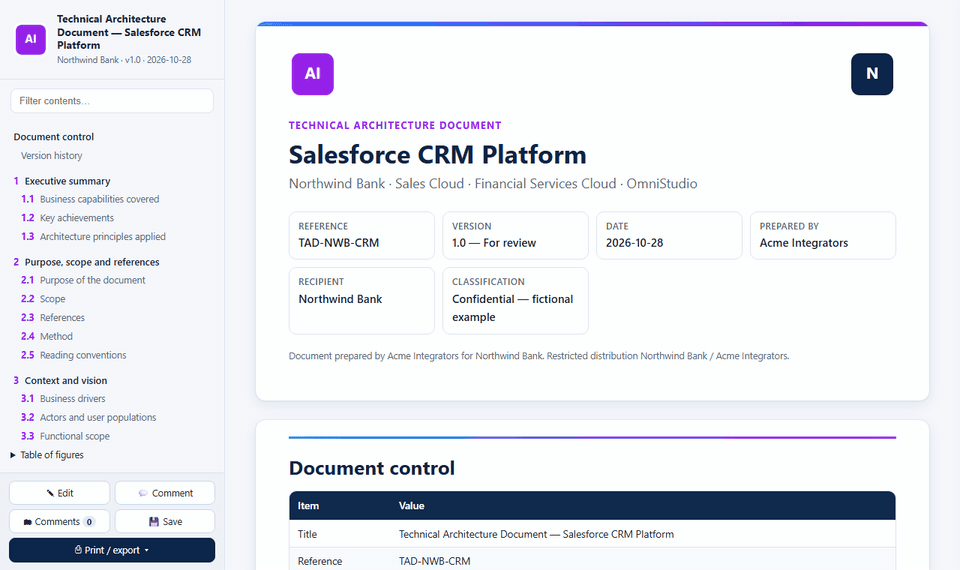
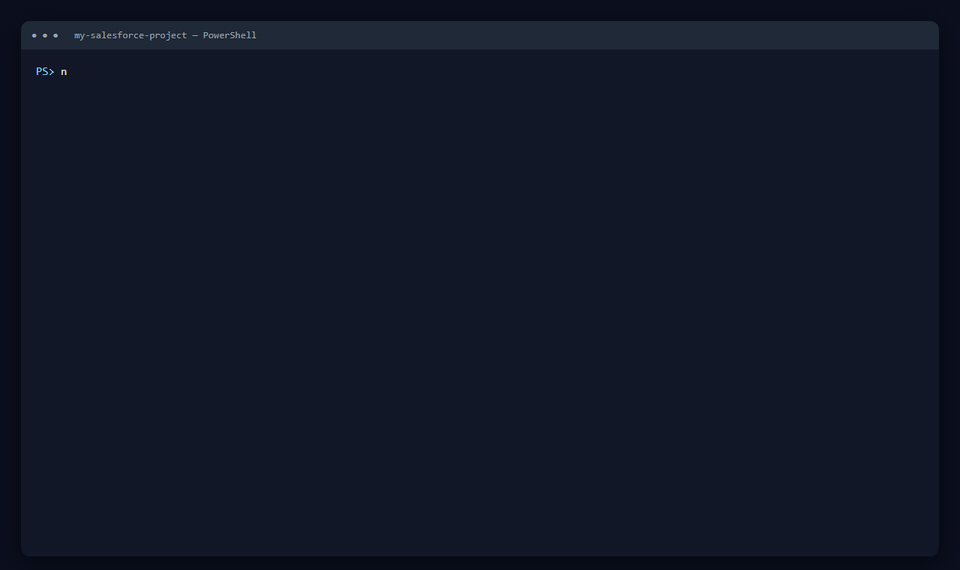

<div align="center">



### Le scribe de l'architecte pour les orgs Salesforce.

**Quatre commandes. Une org. Un document d'architecture technique fondé sur des preuves, reproductible, relu dans le navigateur.**

[English](README.md) · [**Démo en ligne**](https://azamiji.github.io/TADForce/)

</div>


## Pourquoi TADForce

Rédiger le document d'architecture technique d'une org Salesforce prend des semaines, et il est périmé à la release suivante. Un chat IA générique l'écrit en une heure, puis on passe des jours à vérifier ce qu'il a inventé.

TADForce lit l'org comme le ferait un architecte Salesforce senior — chaque classe, Flow, objet, Permission Set Group, Named Credential et OmniScript — et votre agent IA rédige le document à partir de ces preuves. Une seule règle : **pas de preuve, pas de phrase.** Si les métadonnées ne le prouvent pas, l'agent vous pose la question ou écrit « à confirmer ». Il ne devine jamais le nom d'un système, ne documente jamais une fonction décommissionnée et ne tape jamais un chiffre à la main.

<div align="center">

</div>

## ⚡ Démarrage

**Prérequis** : Node.js 20+, Salesforce CLI (`sf`), Chrome ou Edge, un agent IA. `doctor` vérifie tout et installe ce qu'il peut.

À la racine de votre projet Salesforce DX (ou dans un dossier vide) :

```bash
npx tadforce doctor
```

Puis, dans votre agent IA (Claude Code, Codex, Cursor, Copilot…) :

```text
/tadforce
```

| Chemin | Commandes |
|---|---|
| Plugin Claude Code | `/plugin marketplace add azamiji/TADForce` puis `/plugin install tadforce@tadforce` |
| Tout agent (Agent Skills) | `npx tadforce doctor` installe les skills dans `.claude/`, `.agents/`, `.cursor/`, `.codex/`… |
| Déterministe / CI | `npx tadforce prepare --org prod`, puis `npx tadforce build --pdf --docx`, puis `npx tadforce validate` |

## 🧭 Quatre commandes

| Commande | Ce qu'elle fait | Votre part |
|---|---|---|
| `npx tadforce doctor` | Tout ce qui précède la rédaction, en boucle jusqu'à ce que tout soit vert : outils, projet SFDX, connexion à l'org (réutilise la `target-org` du projet, n'ouvre le navigateur que si nécessaire), métadonnées (récupérées depuis l'org avec un manifest `*`, ou vos sources locales), logo et couleurs du client, puis les questions dont seul un humain connaît la réponse | Vous connecter une fois ; valider les réponses recommandées ; nommer les systèmes externes ; confirmer ce qui est inutilisé ou décommissionné |
| `npx tadforce build` | Votre agent rédige chaque section à partir de sa fiche et des faits, puis le document est produit : **HTML** toujours, **PDF** et **Word** à la demande, et validé | — |
| `npx tadforce review` | Ouvre le document pour le commenter. **Enregistrer écrit dans le même fichier** : un seul fichier par document, pas de copies, aucun commentaire perdu. Puis `/tadforce-review` transforme chaque commentaire en correction | Commenter un passage ou capturer une zone, Enregistrer |
| `npx tadforce update` | Quelques mois plus tard : relit l'org, archive les faits précédents, liste les sections touchées par ce qui a changé (une classe Apex ajoutée, un Flow modifié, de nouveaux chiffres…), incrémente la version. `/tadforce-update` ne réécrit que ces sections | — |

<div align="center">

</div>

Les commandes fines (`manifest`, `retrieve`, `facts`, `next`, `validate`…) restent disponibles pour la CI et les experts : `npx tadforce help --all`.

## 📦 Ce que vous obtenez

- **Document d'architecture technique**, destiné au client :
  - en HTML : navigable, modifiable en place, avec commentaire d'un passage ou capture d'une zone, enregistrement dans le même fichier et export PDF ou Word ;
  - en PDF A4 et en DOCX, la version dans le nom du fichier.
- **Axes d'amélioration**, document interne à l'intégrateur : signaux mesurés par pilier Well-Architected, registre `AX-nn` et feuille de route. Ils restent hors du document client.
- **`facts.json`** : l'inventaire déterministe de l'org, identique octet pour octet d'une exécution à l'autre.

Le document porte **le logo et les couleurs du client** : le logo est cherché dans l'org (static resources, content assets, assets des sites) ou fourni par vous ; les couleurs viennent du thème Lightning de l'org, sinon du logo, toujours lisibles (contraste WCAG vérifié). L'intégrateur et l'auteur sont facultatifs : laissés vides, le document ne nomme que le client.

<div align="center">

</div>

## 🧩 Tous les types de projets Salesforce

| Votre situation | Comment TADForce s'y adapte |
|---|---|
| **Une org complète**, état existant | `doctor` récupère tout avec un manifest `*` maîtrisé (130 types, rapports et tableaux de bord dans leurs dossiers, objets standard) |
| **Un projet dans une org partagée** (plusieurs BU, plusieurs intégrateurs) | Périmètre : `--scope "NWB_*,Loan*"` ou `--package-dirs`. Les composants hors périmètre sortent des faits, des chiffres et des tableaux ; les objets standard et les réglages globaux restent |
| **Avant ou pendant le build** | Fournissez vos spécifications fonctionnelles (`--specs SFD.pdf,…`) : elles deviennent des preuves (niveau P2/P3) à côté des métadonnées |
| **Sans accès à l'org**, sources seules | `--source local` documente les package directories du projet |
| **Packages unlocked ou managés** | Namespaces et packages installés sont détectés et documentés avec leurs preuves |
| **Tous les clouds, toutes les industries** | Une section ne s'active que si le produit est détecté, avec sa fiche de rédaction |

- **Clouds** : Sales, Service, Field Service, Experience, Marketing, Commerce, CPQ et Revenue ;
- **Industries** : Financial Services, Insurance, Health, Life Sciences, Manufacturing, Automotive, Consumer Goods, Communications, Public Sector, Education, Nonprofit, Loyalty, Net Zero ;
- **Plateforme** : OmniStudio, Data Cloud, Agentforce, CRM Analytics, Platform Events, Shield, MuleSoft, Heroku et Slack.

## 🔒 Lecture seule par construction

- **Liste blanche des commandes `sf`** : pas de deploy, pas de suppression, pas d'exécution d'Apex.
- **Garde-fou SOQL** : seuls les objets de configuration de l'org et les agrégats sont lus, jamais les données métier.
- **`force-app` jamais modifié** : la récupération se fait dans `tadforce/.snapshot`.
- **Aucun secret dans le texte** : la validation bloque les secrets et les identifiants d'org.

**Ce qui sort de votre poste** : le CLI TADForce n'envoie rien nulle part — ni télémétrie, ni serveur, ni compte. Il parle à votre org via votre propre Salesforce CLI, et au web seulement quand **vous** lui donnez l'URL d'un logo. Votre agent IA lit les métadonnées, les faits et les spécifications que vous fournissez pour rédiger, exactement comme lorsque vous lui faites lire votre code. Utilisez l'agent et les réglages de confidentialité validés par votre entreprise pour les travaux client.

## 🎯 Reproductible

- **Les chiffres sont des placeholders**, par exemple `{{n:apex.classes}}`.
- **Les tableaux, les ERD, la hiérarchie des rôles et les annexes sont générés.**
- **84 fiches de section** cadrent la rédaction de n'importe quel agent.
- **`npx tadforce validate`** bloque tout ce qui ne doit pas être livré.

## 👤 Auteur

<table>
<tr>
<td width="110"></td>
<td>

**Jihad AZAMI HASSANI**<br>
Salesforce Technical Architect, 10+ ans d'expérience · Claude Certified Architect · Leader du Salesforce Architect Community Group de Casablanca<br>
[](https://www.linkedin.com/in/jihadazami/)<br>
[LinkedIn](https://www.linkedin.com/in/jihadazami/) · [GitHub](https://github.com/azamiji)

</td>
</tr>
</table>

## ⚖️ Licence

[Apache-2.0](LICENSE). Salesforce et les noms de ses produits sont des marques de Salesforce, Inc. TADForce est un projet communautaire indépendant, ni affilié à Salesforce ni approuvé par elle. L'organisation de l'exemple (Northwind Bank, Acme Integrators) est fictive.
