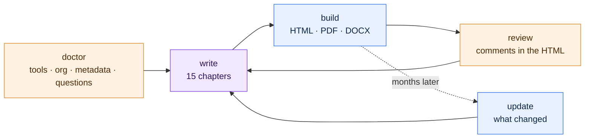

<div align="center">


### AI-Powered Salesforce Technical Documentation

**Four commands. One org. One Technical Architecture Document — evidence-based, reproducible, reviewable in the browser.**

[](https://www.npmjs.com/package/tadforce)
[](LICENSE)
[](https://github.com/azamiji/TADForce/stargazers)
[](https://github.com/azamiji/TADForce/actions)


[](https://agentskills.io)
[](#-quick-start)
[](#-quick-start)
[](#-quick-start)
[](#-quick-start)
[](#-read-only-by-design)

[**Live demo**](https://azamiji.github.io/TADForce/) · [Quick start](#-quick-start) · [The four commands](#-four-commands) · [Every project type](#-every-kind-of-salesforce-project)

</div>


## Why TADForce

Writing the Technical Architecture Document of a Salesforce org takes weeks, and it is out of date at the next release. A generic AI chat writes it in an hour, then you spend days checking what it made up.

TADForce reads the org the way a senior Salesforce architect would — every class, flow, object, permission set group, named credential and OmniScript — and your AI agent writes the document from that evidence. One rule: **no evidence, no sentence.** If the metadata does not prove it, the agent asks you or writes *to be confirmed*. It never guesses the name of a system, never documents a feature you switched off, and never types a number by hand.

<div align="center">

<br><sub>The generated document: navigable contents, KPI tiles that link to their appendix, figures drawn from the metadata.</sub>
</div>

## 🚀 Quick start

**Prerequisites:** Node.js 20+, the [Salesforce CLI](https://developer.salesforce.com/tools/salesforcecli) (`sf`), Chrome or Edge, and an AI agent. `doctor` checks all of it and installs what it can.

From your Salesforce DX project (or an empty folder):

```bash
npx tadforce doctor
```

That one command installs everything: it downloads TADForce, installs the agent skills in your project, connects to the org, collects the metadata and asks you the few questions only a human can answer. When everything is green, it says so and **offers to hand over to your AI agent** (Claude Code, Codex, Gemini CLI or Cursor, detected on your machine), which writes, builds and validates the document — nothing else to type.

Already in your agent? Type `/tadforce`: it runs the same checks, then writes.

<table>
<tr><th width="33%">A — Claude Code plugin</th><th width="33%">B — Any agent (Agent Skills)</th><th width="33%">C — Deterministic / CI</th></tr>
<tr valign="top"><td>

```text
/plugin marketplace add azamiji/TADForce
/plugin install tadforce@tadforce
/tadforce
```

</td><td>

```bash
npx tadforce doctor
# skills land in .claude/, .agents/,
# .cursor/, .codex/… (detected)
```
then ask your agent: *“run /tadforce”*

</td><td>

```bash
npx tadforce prepare --org prod
npx tadforce build --pdf --docx
npx tadforce validate --json
```

</td></tr>
</table>

## 🧭 Four commands

| Command | What it does | Your part |
|---|---|---|
| `npx tadforce doctor` | Everything before the writing, in one loop until all is green: tools, SFDX project, org connection (reuses the project's `target-org`, opens the browser only when needed), metadata (retrieved from the org with a `*` manifest, or your local sources), client logo and colours, then the questions only a human can answer | Log in once; confirm the answers it recommends; name the external systems; confirm what is unused or decommissioned |
| `npx tadforce build` | Your agent writes each section from its specification and the facts, then the document is built: **HTML** always, **PDF** and **Word** on demand, and validated | — |
| `npx tadforce review` | Opens the document to comment it. **Save writes into the same file** — one file per document, no copies, no lost comments. Then `/tadforce-review` turns every comment into a fix | Comment a passage or capture an area, Save |
| `npx tadforce update` | Months later: reads the org again, archives the previous facts, lists the sections touched by what changed (a new Apex class, a modified flow, new counts…), bumps the version. `/tadforce-update` rewrites only those sections | — |

<div align="center">

<br><sub><code>doctor</code>: one loop, a recommended answer for every question.</sub>
</div>



<sub>Blue: the CLI (deterministic). Violet: your agent (judgement). Orange: you (one login, one batch of questions, one review).</sub>

The fine-grained commands (`manifest`, `retrieve`, `facts`, `next`, `validate`…) are still there for CI and experts: `npx tadforce help --all`.

## 📦 What you get

| Deliverable | For | Contents |
|---|---|---|
| **Technical Architecture Document** — HTML | the client | Navigable, searchable, **edit in place**, **comment a passage or capture an area**, saved in the same file, export PDF / Word from the page |
| **Technical Architecture Document** — PDF / DOCX | the client's archive | Print-ready A4 with page numbers; Word document from the same source; the version in the file name |
| **Improvement Axes** — HTML / PDF / DOCX | the integrator | Measured signals per Well-Architected pillar, register `AX-nn`, roadmap — kept out of the client document |
| `facts/facts.json` | everyone | The deterministic inventory of the org, byte-identical from one run to the next |

The document carries **the client's logo and colours**: the logo is searched in the org (static resources, content assets, site assets) or given by you; the colours come from the org's Lightning theme, else from the logo — always readable (WCAG contrast checked). The integrator and the author are optional: leave them blank and the document names the client only.

<div align="center">

<br><sub>The review loop: comment in the page, Save into the same file, then <code>/tadforce-review</code> resolves each comment and answers it.</sub>
</div>

## 🧩 Every kind of Salesforce project

| Your situation | How TADForce handles it |
|---|---|
| **A whole org**, as-built | `doctor` retrieves everything with a curated `*` manifest (105 types — only what the document uses, foldered reports and dashboards, standard objects) |
| **One project in a shared org** (several BUs, several integrators) | Scope: `--scope "NWB_*,Loan*"` or `--package-dirs`. Out-of-scope components leave facts, counts and tables; standard objects and org-wide settings stay |
| **Before or during the build** | Give your functional specifications (`--specs SFD.pdf,…`): they become evidence (level P2/P3) next to the metadata |
| **No org access**, sources only | `--source local` documents the package directories of the project |
| **Unlocked or managed packages** | Namespaces and installed packages are detected and documented with their evidence |
| **Any cloud, any industry** | Sections switch on only when the product is detected, each with its writing guide (below) |
| **Any language** | English and French built in. Any other language (Spanish, German, Italian, Portuguese, Arabic, Japanese…): pick it in `doctor`, your agent translates the headings and labels once, then writes in that language. Salesforce terms stay in English |

### Products and industries

<table>
<tr><td>

**Clouds** · Sales Cloud · Service Cloud · Field Service · Experience Cloud · Marketing (Connect, Account Engagement) · Commerce & Order Management · CPQ, Billing, Revenue Cloud

</td><td>

**Industries** · Financial Services · Insurance · Health · Life Sciences · Manufacturing · Automotive · Consumer Goods · Communications / Media / Energy · Public Sector · Education · Nonprofit · Loyalty · Net Zero

</td><td>

**Platform** · OmniStudio · Data Cloud · Agentforce & Einstein · CRM Analytics · Platform Events & CDC · Shield · MuleSoft, Heroku, Slack, External Services

</td></tr>
</table>

## 🏛️ The document model

Every org gets **the same skeleton** — that is what makes two TADForce documents comparable:

| # | Chapter | Highlights |
|---|---|---|
| — | Document control | Reference, version, classification, history (kept up to date by `update`) |
| 1 | Executive summary | KPI tiles, capabilities, key achievements, principles |
| 2 | Purpose, scope, references | Method, scope, exclusions applied, reading conventions |
| 3 | Context and vision | Drivers, populations, functional scope, key figures |
| 4 | General architecture | Generated context view, products with evidence, layered view, naming conventions |
| 5 | Functional architecture | One section per business domain, with sequences and state diagrams |
| 6 | Data | Generated ERDs (Lookup / Master-Detail only), external IDs, record types, Custom Metadata, events, volumes |
| 7 | Application | Apex layers, triggers and order of execution, async, flows, OmniStudio, Agentforce, key sequences |
| 8 | User interface | Apps, pages, LWC by domain, communication, sites, telephony and Omni-Channel |
| 9 | Integrations | Patterns, `FLX-nn` flow catalogue, one section per connected system, inbound APIs, SSO |
| 10 | Security | Personas and PSGs, generated role hierarchy, OWD, sharing, application security, Shield |
| 11-15 | Reporting · Operations · NFR & Well-Architected · ADRs · Outlook | |
| A-K | Appendices | Generated from facts: Apex, automation, objects, OmniStudio, UI, access, endpoints, packages, traceability, glossary |

## 🔒 Read-only by design

| Guarantee | How |
|---|---|
| Never changes the org | Every `sf` call goes through an allow-list: `org list/display/login`, `list metadata`, `retrieve`, `data query`, `config get`. `deploy`, `delete`, `apex run`… are refused. |
| Never reads business data | SOQL guard: only org configuration objects, or aggregates (`COUNT()`, `MAX(CreatedDate)`, `GROUP BY` counts on users and assignments). |
| Never touches your project | Retrieve goes to `tadforce/.snapshot` (git-ignored); `force-app` is untouched. |
| Never leaks secrets | Credentials are never retrieved; `validate` blocks tokens, passwords, private keys and org IDs in the text. |

### What leaves your machine

The TADForce CLI sends nothing anywhere: no telemetry, no server, no account. It talks to your org through your own Salesforce CLI, and to the web only when **you** give it a logo URL. Your AI agent reads the metadata, the facts and the specifications you provide in order to write — exactly as when you ask it to read your code. Use the agent and the data-handling settings your company approved for client work.

## 🎯 Reproducible by construction

- **Facts are code, not prose.** `facts.json` is extracted deterministically (sorted, stable) — tested byte for byte.
- **Numbers are placeholders.** Writers type `{{n:apex.classes}}`, never `132`. Tables, ERDs, role trees, KPIs and appendices are generated.
- **Specs, not prompts.** 84 section specifications (`intent · facts · must · never`) drive every agent the same way.
- **A gate, not a hope.** `npx tadforce validate` fails on unwritten sections, unknown placeholders, identifiers that do not exist in the org, excluded or decommissioned components, forbidden terms, broken anchors, Mermaid errors and secrets.
- **Knowledge that sticks.** Client vocabulary, system names and exclusions live in `knowledge/*.yml`, so a regeneration never brings back a mistake a reader already fixed.

## ⚔️ With vs without TADForce

| | Writing by hand | A generic AI chat | **TADForce** |
|---|---|---|---|
| Time to a first complete draft | weeks | hours, then days of fact-checking | **an afternoon** |
| Figures match the org | until the next release | rarely | **always — generated from facts** |
| Same structure across clients | depends on the author | never | **always — one skeleton, 84 specs** |
| System names and decommissioned features | tribal knowledge | hallucinated | **asked once, enforced forever** |
| Client review | Word comments, copy-paste | — | **comments in the HTML, resolved by the agent** |
| Three months later | start again | start again | **`update`: only what changed** |
| Debt and risks | mixed with the description | mixed | **separate Improvement Axes document** |

## 🧱 Built on

[Salesforce CLI](https://developer.salesforce.com/tools/salesforcecli) · [Agent Skills](https://agentskills.io) · [Salesforce skills (`forcedotcom/sf-skills`)](https://github.com/forcedotcom/sf-skills) · [Mermaid](https://mermaid.js.org) · [Puppeteer](https://pptr.dev) · [markdown-it](https://github.com/markdown-it/markdown-it) · [html2canvas](https://html2canvas.hertzen.com) · [html-docx-js](https://github.com/evidenceprime/html-docx-js)

## 🗺️ Roadmap

- [ ] Built-in skeletons for more languages (es, de, pt, it) — any language already works through the agent; contributions welcome
- [ ] Your own template: add, hide or rename chapters from `tadforce/templates/`
- [ ] More examples: Service + Experience Cloud, an ISV package
- [ ] Salesforce CLI plugin wrapper (`sf tad …`)
- [ ] Dependency graph from `MetadataComponentDependency` (Tooling API)
- [ ] Export to Confluence / SharePoint

## 🤝 Contributing

Issues and pull requests are welcome — new product modules, new extractors, new languages. Read [CONTRIBUTING.md](CONTRIBUTING.md). Run `npm test` before opening a PR: it includes the unit tests and the genericity guard.

## 👥 Community

TADForce was born for the **Salesforce ecosystem**: architects, consultants, integrators and in-house teams who need documentation they can trust.

Your experience is what makes it better. Tell us, in the [issues](https://github.com/azamiji/TADForce/issues) and [discussions](https://github.com/azamiji/TADForce/discussions):

- **How it went** — the kind of org and project, the time it took, what worked out of the box.
- **How good the result was** — sections that read like a senior architect wrote them, and sections that did not.
- **What to improve** — a product it should detect better, a section that misses the point, a question it should have asked.

Please share your feedback, not your documents: they describe your clients' systems.

If TADForce saved you a week, **star the repo** ⭐ — it is how other Salesforce teams find it.

## 👤 Author

<table>
<tr>
<td width="110"></td>
<td>

**Jihad AZAMI HASSANI**<br>
Salesforce Technical Architect, 10+ years of experience · Claude Certified Architect · Salesforce Architect Community Group Leader, Casablanca<br>
[](https://www.linkedin.com/in/jihadazami/)<br>
[LinkedIn](https://www.linkedin.com/in/jihadazami/) · [GitHub](https://github.com/azamiji)

</td>
</tr>
</table>

## ⚖️ License

[Apache-2.0](LICENSE) © Jihad AZAMI HASSANI.

<sub>Salesforce, Sales Cloud, Service Cloud, Agentforce and the other product names are trademarks of Salesforce, Inc. TADForce is an independent community project, not affiliated with, sponsored or endorsed by Salesforce. The example organization (Northwind Bank, Acme Integrators) is fictional.</sub>
