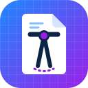
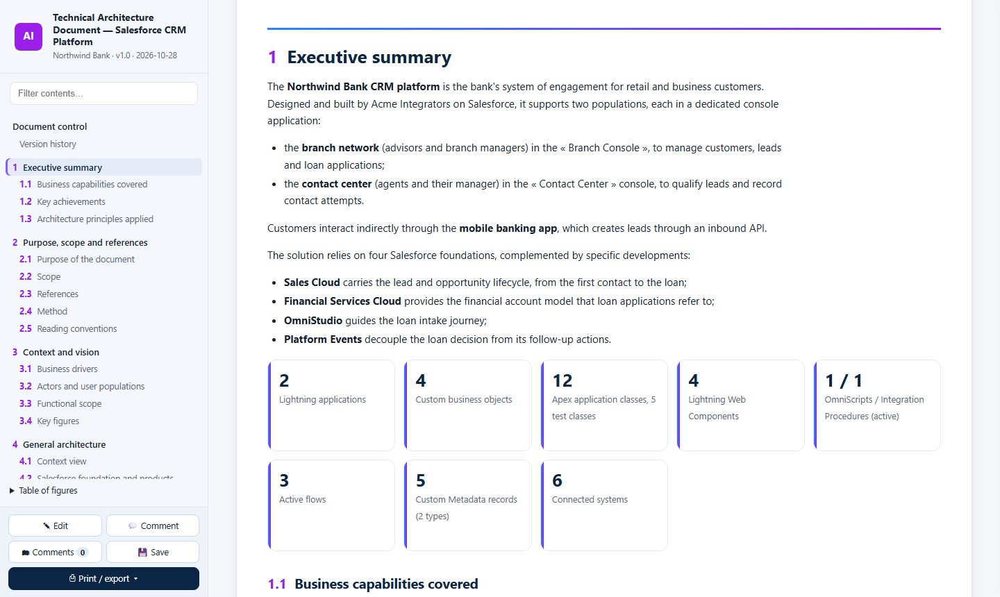
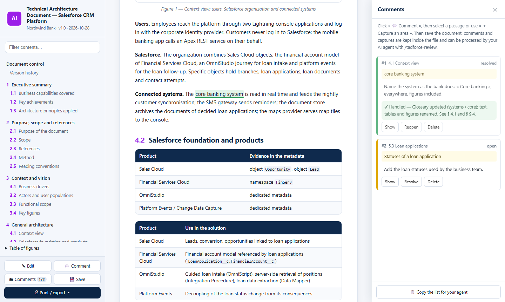

<div align="center">



### The architect's scribe for Salesforce orgs.

**One command. One org. One Technical Architecture Document — evidence-based, reproducible, reviewable in the browser.**

[](https://www.npmjs.com/package/tadforce)
[](LICENSE)
[](https://github.com/OWNER/TADForce/stargazers)
[](https://github.com/OWNER/TADForce/actions)


[](https://agentskills.io)
[](#-quick-start)
[](#-quick-start)
[](#-quick-start)
[](#-quick-start)
[](#-read-only-by-design)

[**Live demo**](https://OWNER.github.io/TADForce/) · [Quick start](#-quick-start) · [How it works](#-what-happens-when-you-run-tadforce) · [The document model](#%EF%B8%8F-the-document-model) · [Français](README.fr.md)

</div>


## 👋 Meet Tad



Tad is a compass with a T-square for arms. It reads your org the way a senior Salesforce architect would: every class, flow, object, permission set group, named credential and OmniScript. Then it writes the document your client actually reads.

Tad has one rule: **no evidence, no sentence.** If the metadata does not prove it, Tad either asks you or writes *to be confirmed*. It never guesses the name of a system, never documents a feature you switched off, and never types a number by hand.


## ⚡ One command. One org. One architecture document.

```bash
npx tadforce init          # workspace + agent skills + prerequisite check
```

Then, in your AI agent (Claude Code, Codex, Cursor, Copilot…), from your Salesforce DX project:

```text
/tadforce
```

Tad checks the prerequisites, asks you to log in to the org, retrieves every metadata type with a `*` manifest, extracts the facts, asks the handful of questions only a human can answer, writes all 15 chapters, builds **HTML + PDF + DOCX**, validates, and hands you the files. Then your client comments directly in the HTML, and `/tadforce-review` folds every comment back in.

<div align="center">

<br><sub>The generated document: navigable contents, KPI tiles that link to their appendix, figures drawn from the metadata.</sub>
</div>

## 🚀 Quick start

**Prerequisites:** Node.js 20+, the [Salesforce CLI](https://developer.salesforce.com/tools/salesforcecli) (`sf`), Chrome or Edge, and an AI agent. `tadforce doctor` checks all of it and tells you what to do.

<table>
<tr><th width="33%">A — Claude Code plugin</th><th width="33%">B — Any agent (Agent Skills)</th><th width="33%">C — Deterministic / CI</th></tr>
<tr valign="top"><td>

```text
/plugin marketplace add OWNER/TADForce
/plugin install tadforce@tadforce
/tadforce
```

</td><td>

```bash
npx tadforce init
# skills land in .claude/, .agents/,
# .cursor/, .codex/… (detected)
```
then ask your agent: *“run /tadforce”*

</td><td>

```bash
npx tadforce prepare --org prod
npx tadforce build --pdf --docx
npx tadforce validate --json
```

</td></tr>
</table>

> [!TIP]
> On Windows, run the commands from PowerShell or Git Bash. Sandboxes: `npx tadforce auth --alias uat --sandbox`.

## 🧭 What happens when you run `/tadforce`

```mermaid
flowchart LR
  A["doctor<br>prerequisites"]:::s --> B["auth<br>browser login"]:::h
  B --> C["manifest<br>every type *"]:::s
  C --> D["retrieve<br>read-only snapshot"]:::s
  D --> E["facts<br>deterministic JSON"]:::s
  E --> F["questions<br>systems · exclusions"]:::h
  F --> G["write<br>15 chapters"]:::a
  G --> H["build<br>HTML · PDF · DOCX"]:::s
  H --> I["validate<br>0 error"]:::s
  I --> J["review<br>comments in the HTML"]:::h
  J --> G
  classDef s fill:#E8F1FF,stroke:#2F6FE4,color:#0B2545
  classDef a fill:#F1E8FF,stroke:#7B3FE4,color:#2A1458
  classDef h fill:#FFF2E2,stroke:#E0861F,color:#4A2A05
```



<sub>Blue: the CLI (deterministic). Violet: your agent (judgement). Orange: you (one login, one batch of questions, one review).</sub>

| Step | Command | Who |
|---|---|---|
| Prerequisites | `npx tadforce doctor` | Tad fixes what it can, tells you the rest |
| Org access | `npx tadforce auth --alias prod` | **You** log in once in the browser |
| Snapshot | `npx tadforce prepare --org prod` | curated manifest (130 types, `*`, folders and standard objects expanded) → retrieve into `tadforce/.snapshot` → facts → skeleton |
| Questions | `tadforce/facts/questions.json` | **You** name the external systems and confirm what is unused or decommissioned |
| Writing | `npx tadforce next` | Your agent writes each section from its spec and the facts |
| Build | `npx tadforce build --pdf --docx` | HTML (editable, commentable), PDF, Word |
| Review | `/tadforce-review` | Comments become fixes in the sources *and* in the knowledge files |

## 📦 What you get

| Deliverable | For | Contents |
|---|---|---|
| **Technical Architecture Document** — HTML | the client | Navigable, searchable, **edit in place**, **comment a passage or capture an area**, save to the same file, export PDF / Word from the page |
| **Technical Architecture Document** — PDF / DOCX | the client's archive | Print-ready A4 with page numbers; Word document from the same source |
| **Improvement Axes** — HTML / PDF / DOCX | the integrator | Measured signals per Well-Architected pillar, register `AX-nn`, roadmap — kept out of the client document |
| `facts/facts.json` | everyone | The deterministic inventory of the org, byte-identical from one run to the next |

<div align="center">

<br><sub>The review loop: the client comments in the HTML; the agent resolves each comment and answers it in the next version.</sub>
</div>

## 🏛️ The document model

Every org gets **the same skeleton** — that is what makes two TADForce documents comparable:

| # | Chapter | Highlights |
|---|---|---|
| — | Document control | Reference, version, classification, history |
| 1 | Executive summary | KPI tiles, capabilities, key achievements, principles |
| 2 | Purpose, scope, references | Method, exclusions applied, reading conventions |
| 3 | Context and vision | Drivers, populations, functional scope, key figures |
| 4 | General architecture | Generated context view, products with evidence, layered view, naming conventions |
| 5 | Functional architecture | One section per business domain, with sequences and state diagrams |
| 6 | Data | Generated ERDs (Lookup / Master-Detail only), external IDs, record types, Custom Metadata, events, volumes |
| 7 | Application | Apex layers, triggers and order of execution, async, flows, OmniStudio, Agentforce, key sequences |
| 8 | User interface | Apps, pages, LWC by domain, communication, sites, telephony and Omni-Channel |
| 9 | Integrations | Patterns, `FLX-nn` flow catalogue, one section per connected system, inbound APIs, SSO |
| 10 | Security | Personas and PSGs, generated role hierarchy, OWD, sharing, application security, Shield |
| 11-15 | Reporting · Operations · NFR & Well-Architected · ADRs · Outlook | |
| A-K | Appendices | Generated from facts: Apex, automation, objects, OmniStudio, UI, access, endpoints, packages, traceability, glossary |

Sections switch on **only when the product is detected** — each with its own writing guide:

<table>
<tr><td>

**Clouds** · Sales Cloud · Service Cloud · Field Service · Experience Cloud · Marketing (Connect, Account Engagement) · Commerce & Order Management · CPQ, Billing, Revenue Cloud

</td><td>

**Industries** · Financial Services · Insurance · Health · Life Sciences · Manufacturing · Automotive · Consumer Goods · Communications / Media / Energy · Public Sector · Education · Nonprofit · Loyalty · Net Zero

</td><td>

**Platform** · OmniStudio · Data Cloud · Agentforce & Einstein · CRM Analytics · Platform Events & CDC · Shield · MuleSoft, Heroku, Slack, External Services

</td></tr>
</table>

## 🔒 Read-only by design

| Guarantee | How |
|---|---|
| Never changes the org | Every `sf` call goes through an allow-list: `org list/display/login`, `list metadata`, `retrieve`, `data query`. `deploy`, `delete`, `apex run`… are refused. |
| Never reads business data | SOQL guard: only org configuration objects, or aggregates (`COUNT()`, `MAX(CreatedDate)`, `GROUP BY` counts on users and assignments). |
| Never touches your project | Retrieve goes to `tadforce/.snapshot` (git-ignored); `force-app` is untouched. |
| Never leaks secrets | Credentials are never retrieved; `validate` blocks tokens, passwords, private keys and org IDs in the text. |

## 🎯 Reproducible by construction

- **Facts are code, not prose.** `facts.json` is extracted deterministically (sorted, stable) — tested byte for byte.
- **Numbers are placeholders.** Writers type `{{n:apex.classes}}`, never `132`. Tables, ERDs, role trees, KPIs and appendices are generated.
- **Specs, not prompts.** 84 section specifications (`intent · facts · must · never`) drive every agent the same way: `npx tadforce next` hands over the next one.
- **A gate, not a hope.** `npx tadforce validate` fails on unwritten sections, unknown placeholders, identifiers that do not exist in the org, excluded or decommissioned components, forbidden terms, broken anchors, Mermaid errors and secrets.
- **Knowledge that sticks.** Client vocabulary, system names and exclusions live in `knowledge/*.yml`, so a regeneration never brings back a mistake a reader already fixed.

## ⚔️ With vs without TADForce

| | Writing by hand | A generic AI chat | **TADForce** |
|---|---|---|---|
| Time to a first complete draft | weeks | hours, then days of fact-checking | **an afternoon** |
| Figures match the org | until the next release | rarely | **always — generated from facts** |
| Same structure across clients | depends on the author | never | **always — one skeleton, 84 specs** |
| System names and decommissioned features | tribal knowledge | hallucinated | **asked once, enforced forever** |
| Client review | Word comments, copy-paste | — | **comments in the HTML, resolved by the agent** |
| Debt and risks | mixed with the description | mixed | **separate Improvement Axes document** |

## 🧩 Built on

[Salesforce CLI](https://developer.salesforce.com/tools/salesforcecli) · [Agent Skills](https://agentskills.io) · [Salesforce skills (`forcedotcom/sf-skills`)](https://github.com/forcedotcom/sf-skills) · [Mermaid](https://mermaid.js.org) · [Puppeteer](https://pptr.dev) · [markdown-it](https://github.com/markdown-it/markdown-it) · [html2canvas](https://html2canvas.hertzen.com) · [html-docx-js](https://github.com/evidenceprime/html-docx-js)

## 🗺️ Roadmap

- [ ] `tadforce diff` — what changed between two snapshots, as a release note for architects
- [ ] More languages for the skeletons (es, de, pt, it, ar)
- [ ] Salesforce CLI plugin wrapper (`sf tad …`)
- [ ] Dependency graph from `MetadataComponentDependency` (Tooling API)
- [ ] Themes for client branding (fonts, cover layouts)

## 🤝 Contributing

Issues and pull requests are welcome — new product modules, new extractors, new languages. Read [CONTRIBUTING.md](CONTRIBUTING.md). Run `npm test` before opening a PR: it includes the unit tests and the genericity guard.

## 👥 Community

TADForce was born in the **Salesforce Architect Community Group of Casablanca**. Come and share your generated documents (anonymised!), your module ideas and your war stories. Star the repo if Tad saved you a week. ⭐

## 👤 Author

<table>
<tr>
<td width="96"></td>
<td>

**Jihad AZAMI HASSANI**<br>
Salesforce Technical Architect · Leader of the Salesforce Architect Community Group, Casablanca<br>
<sub>LinkedIn · Trailblazer profile — links to come</sub>

</td>
</tr>
</table>

## ⚖️ License

[Apache-2.0](LICENSE) © Jihad AZAMI HASSANI.

<sub>Salesforce, Sales Cloud, Service Cloud, Agentforce and the other product names are trademarks of Salesforce, Inc. TADForce is an independent community project, not affiliated with, sponsored or endorsed by Salesforce. The example organization (Northwind Bank, Acme Integrators) is fictional.</sub>
