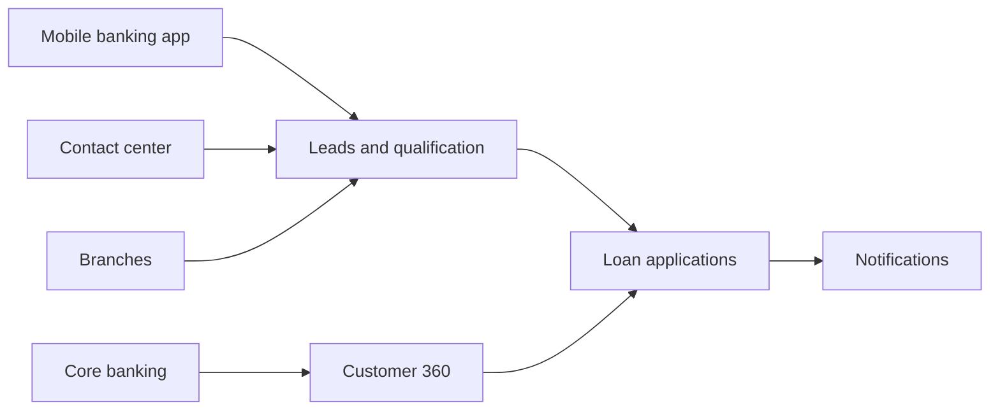
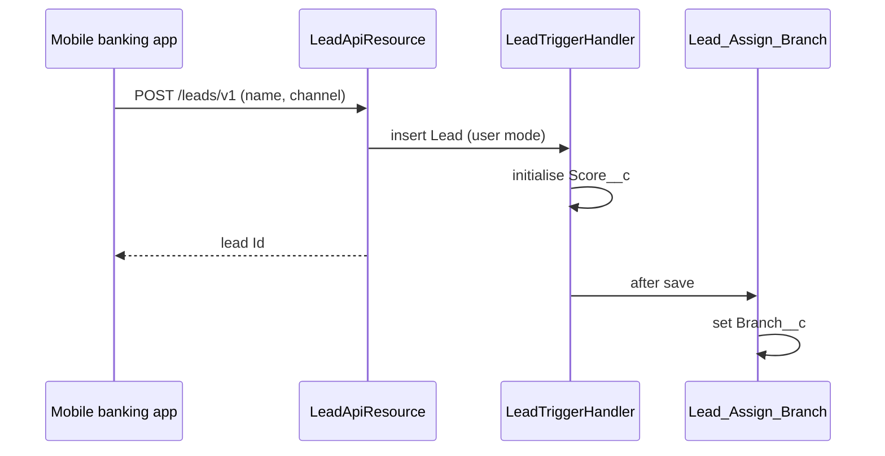
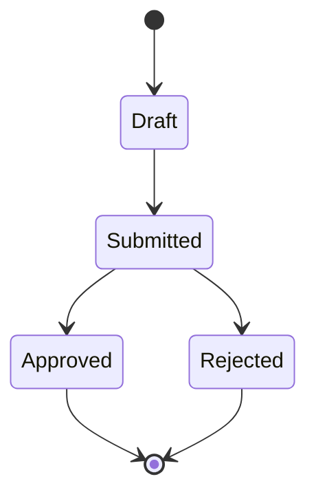

# Functional architecture and business processes {#ch-functional}

## Functional domains {#functional-domains}

Figure: Functional domains and their sequence, from the first contact to the loan

| Domain | Main objects | Main components | Section |
|---|---|---|---|
| Leads and qualification | `Lead`, `ContactAttempt__c` | `LeadApiResource`, `LeadTrigger`, `Lead_Assign_Branch` | {{ref:fn-leads}} |
| Loan applications | `LoanApplication__c`, `LoanDocument__c` | `NWB_LoanIntake_English_1`, `LoanApplicationTrigger`, `LoanScoringService` | {{ref:fn-loans}} |
| Customer 360 | `Account` | `customer360`, `Customer360Controller`, `CoreBankingClient` | {{ref:fn-customer-360}} |
| Notifications | `LoanStatusChange__e` | `Loan_Status_Notification`, `Loan_Document_Reminder`, `SmsNotificationService` | {{ref:fn-notifications}} |
| Contact center | `Lead`, `ContactAttempt__c` | Queue `Contact_Center_Leads`, « Contact Center » console | {{ref:fn-contact-center}} |

## Leads and qualification {#fn-leads}

Leads come from three channels: the mobile banking app, the branches and the contact center.

- The mobile app calls the Apex REST service `LeadApiResource` (`/leads/v1/*`). The lead is inserted in user mode with its channel (`Channel__c`).
- At creation, `LeadTrigger` delegates to `LeadTriggerHandler`, which initialises the score (`Score__c`).
- The record-triggered flow `Lead_Assign_Branch` then assigns the lead to its branch (`Branch__c`).
- Leads waiting for the contact center are owned by the queue `Contact_Center_Leads`.
- A converted lead can no longer change status: the validation rule `Lead_Locked_When_Converted` enforces it.

Figure: Creation of a lead from the mobile banking app

## Loan applications {#fn-loans}

A loan application (`LoanApplication__c`) is created from the customer record (quick action `Account.New_Loan_Application`), from the « New loan » tab (`loanWizard`) or through the guided OmniScript `NWB_LoanIntake_English_1`. Its record type distinguishes consumer loans from mortgages.

- **Scoring.** Before each save, `LoanApplicationTriggerHandler` asks `LoanScoringService` to compute `Score__c` from the `ScoringRule__mdt` rules.
- **Review.** Submitted applications are shared in read-only mode with the branch managers (sharing rule `Share_Submitted_With_Review_Team`); the queue `Loan_Review` holds the applications waiting for a reviewer.
- **Decision.** Each status change publishes a `LoanStatusChange__e` event. When the status becomes « Approved » or « Rejected », the documents are archived by `DocumentArchiveQueueable`.
- **Documents.** Each document is a `LoanDocument__c` record, child of its application (master-detail), with its archive identifier (`ArchiveId__c`).

Figure: Statuses of a loan application (values to be confirmed with the business team)

> [!INTEGRATOR]
> Scoring rules are data, not code: the business team adjusts weights and criteria in `ScoringRule__mdt` without a release.

## Customer 360 {#fn-customer-360}

On the customer record page (`Account_Record_Page`), the `customer360` component displays the customer's positions read live from the core banking system:

1. the component calls `Customer360Controller.getPositions` through a cached wire adapter;
2. the controller reads the customer number (`NWB_CustomerNumber__c`) in user mode;
3. `CoreBankingClient` calls the core banking API through the named credential `NWB_CoreBanking`;
4. each position is rendered by `positionTile`.

Each night, `CustomerSyncBatch` refreshes the customer segment (`Segment__c`) from the same API.

## Notifications {#fn-notifications}

- **Status change.** The flow `Loan_Status_Notification` subscribes to `LoanStatusChange__e` and creates a follow-up task for the owner.
- **Missing documents.** The scheduled flow `Loan_Document_Reminder` runs daily on loan applications and calls the invocable action of `SmsNotificationService`, which sends the SMS through the SMS gateway asynchronously.

## Contact center {#fn-contact-center}

Agents work in the « Contact Center » console on the leads of the queue `Contact_Center_Leads`. Each call is recorded as a contact attempt (`ContactAttempt__c`) linked to the lead or the customer, with its outcome (`Outcome__c`).
