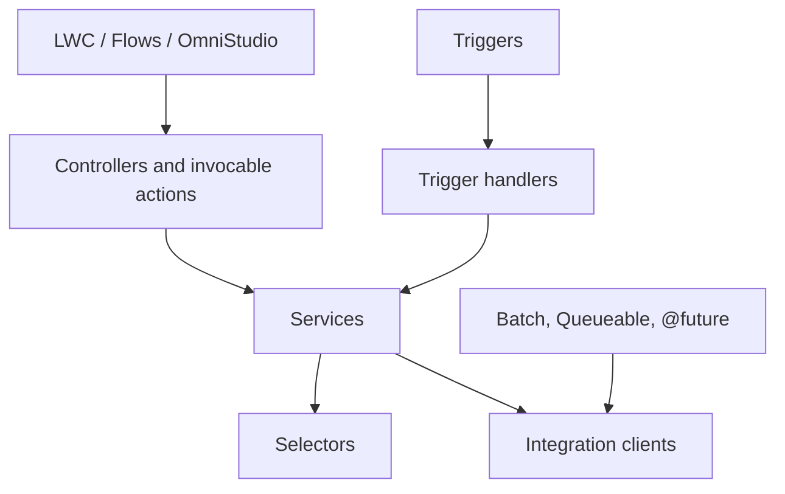
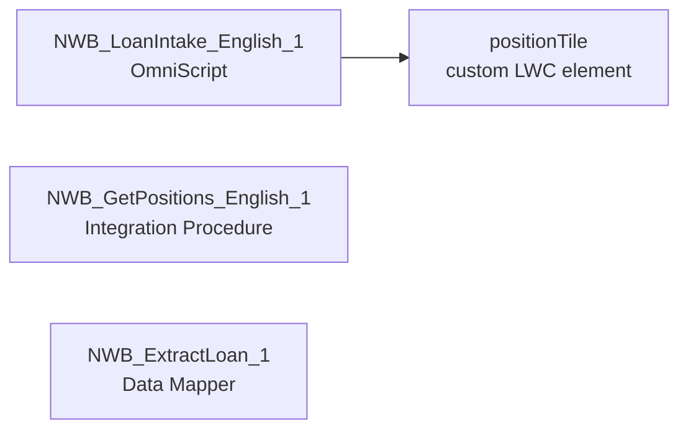

# Application architecture {#ch-application}

## Apex code architecture {#app-apex}

@@ANNEX:apex-summary@@

### Design principles {#app-apex-principles}

- One trigger per object, with no logic in the trigger body: each trigger calls the `run()` method of its handler.
- Business rules live in services (`LoanScoringService`), data access in selectors (`LoanApplicationSelector`), external calls in clients (`CoreBankingClient`).
- Code processes lists of records, never one record at a time.
- {{n:apex.withSharing}} classes declare `with sharing`; queries from user-facing code run `WITH USER_MODE`.

### Layers and conventions {#app-apex-layers}

Figure: Layers of the Apex code

| Layer | Convention | Examples |
|---|---|---|
| Trigger handlers | `<Object>TriggerHandler` | `LoanApplicationTriggerHandler`, `LeadTriggerHandler` |
| Services | `<Domain>Service` | `LoanScoringService`, `SmsNotificationService` |
| Selectors | `<Object>Selector` | `LoanApplicationSelector` |
| Controllers | `<Component>Controller` | `Customer360Controller` |
| Integration clients | `<System>Client` | `CoreBankingClient` |
| Asynchronous jobs | `*Batch`, `*Queueable` | `CustomerSyncBatch`, `DocumentArchiveQueueable` |
| Exposed services | `*Resource` | `LeadApiResource` |

### Classes by functional domain {#app-apex-domains}

| Domain | Main classes | Role |
|---|---|---|
| Loans | `LoanApplicationTriggerHandler`, `LoanScoringService`, `LoanApplicationSelector`, `DocumentArchiveQueueable` | Scoring, events, archiving |
| Customer 360 | `Customer360Controller`, `CoreBankingClient`, `CustomerSyncBatch` | Live positions, nightly synchronisation |
| Leads | `LeadApiResource`, `LeadTriggerHandler` | Inbound API, initialisation |
| Notifications | `SmsNotificationService` | SMS reminders |
| Access | `SsoRegistrationHandler` | User creation at single sign-on |

## Triggers {#app-triggers}

| Object | Trigger | Handler | Events |
|---|---|---|---|
| `LoanApplication__c` | `LoanApplicationTrigger` | `LoanApplicationTriggerHandler` | before insert, before update, after update |
| `Lead` | `LeadTrigger` | `LeadTriggerHandler` | before insert |

### Order of execution {#app-order}

On `Lead`, the trigger runs before save (score initialisation); the flow `Lead_Assign_Branch` runs after save (branch assignment). On `LoanApplication__c`, scoring happens before save, then the event is published and the archiving job is enqueued after update.

## Cross-cutting mechanisms {#app-mechanisms}

**Loan status propagation.** A single place detects status changes and publishes them; every consequence is a subscriber.

@@SEQ:loan-status@@

## Asynchronous and scheduled processing {#app-async}

| Job | Type | Trigger or schedule | Purpose |
|---|---|---|---|
| `CustomerSyncBatch` | Batch and Schedulable (batches of 50) | Scheduled (schedule to be confirmed) | Refresh the customer segment from the core banking system |
| `DocumentArchiveQueueable` | Queueable with callouts | Status « Approved » or « Rejected » | Archive the documents of the application |
| `SmsNotificationService.send` | `@future` with callout | Invocable action of `Loan_Document_Reminder` | Send the SMS reminders |

## Flows {#app-flows}

Flows handle simple record automation and scheduling; Apex handles scoring, integrations and volume.

| Flow | Type | Object | Purpose |
|---|---|---|---|
| `Lead_Assign_Branch` | Record-triggered, after save, on create | `Lead` | Assign the branch of the lead |
| `Loan_Document_Reminder` | Scheduled, daily | `LoanApplication__c` | Remind customers of missing documents by SMS |
| `Loan_Status_Notification` | Platform event-triggered | `LoanStatusChange__e` | Create a follow-up task |

The full list is in {{ref:annex-automation}}.

<!-- tad:if modules.omnistudio -->
## OmniStudio {#app-omnistudio}

Figure: OmniStudio components of the loan intake

| Component | Type | Role |
|---|---|---|
| `NWB_LoanIntake_English_1` | OmniScript (`NWB/LoanIntake`) | Guided loan intake; reuses the `positionTile` component to show the customer's positions |
| `NWB_GetPositions_English_1` | Integration Procedure | Server-side retrieval of positions (steps to be confirmed) |
| `NWB_ExtractLoan_1` | Data Mapper (extract) | Extraction of loan data (fields to be confirmed) |
<!-- tad:endif -->

<!-- tad:if modules.agentforce -->
## Agentforce and artificial intelligence {#app-ai}

<!-- tad:pending application.ai -->
<!-- tad:endif -->

## Key sequences {#app-sequences}

**Nightly customer synchronisation.**

@@SEQ:customer-sync@@
