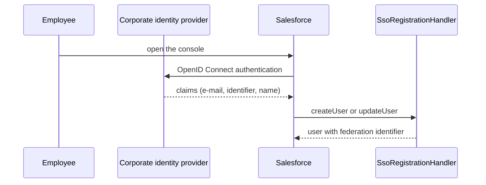

# Security and access {#ch-security}

## Principles {#sec-principles}

- Least privilege: a minimal profile, rights added by persona through permission set groups.
- Record access follows the network: private defaults, opened by the role hierarchy and by targeted sharing rules.
- Security is enforced on the server: `with sharing`, user-mode queries, inbound API in user mode.
- No secret in code or configuration files: authentication is held by external credentials.

## Authentication and user provisioning {#sec-auth}

Figure: Single sign-on and user creation

The assignment of permission set groups after creation is to be confirmed with the bank (manual or automated).

## Personas and permission set groups {#sec-personas}

| Persona | Permission set group | Main rights |
|---|---|---|
| Branch advisor | `NWB_Persona_Advisor` | `NWB_Advisor`: loan applications and contact attempts (create, edit), branches (read) |
| Branch manager | `NWB_Persona_Branch_Manager` | `NWB_Advisor` and `NWB_Branch_Manager`: branches (edit) |
| Contact center agent | `NWB_Persona_Agent` | `NWB_Contact_Center_Agent`: contact attempts |

Two technical permission sets complete the model: `NWB_Integration_API` (API access for the integration user) and `NWB_Support_Admin` (support administration).

## Role hierarchy {#sec-roles}

@@FIGURE:roles|Role hierarchy@@

The hierarchy mirrors the network: chief executive, network director, regional directors, branch managers and advisors per region, and a separate branch for the contact center.

## Sharing model {#sec-sharing}

### Organization-wide defaults {#sec-owd}

@@ANNEX:owd@@

Customers, leads, opportunities and loan applications are private; branches are readable by all; loan documents follow their application.

### Sharing rules and queues {#sec-rules}

@@ANNEX:sharing-rules@@

@@ANNEX:queues@@

Submitted loan applications are opened in read-only mode to the group `All_Branch_Managers`, which includes the managers' superiors. Queues hold the work not yet assigned: loan applications to review and leads for the contact center.

## Application security {#sec-app}

- {{n:apex.withSharing}} classes declare `with sharing` and {{n:apex.inheritedSharing}} `inherited sharing`; the nightly synchronisation runs `without sharing` as a system job.
- Queries from the Customer 360 and the selectors run `WITH USER_MODE`; the inbound API inserts as user.
- Validation rules protect data consistency (`Lead_Locked_When_Converted`, `Amount_Must_Be_Positive`).

<!-- tad:if modules.shield -->
## Shield and compliance {#sec-shield}

<!-- tad:pending security.shield -->
<!-- tad:endif -->

## Session settings and protections {#sec-session}

| Setting | Value |
|---|---|
| Session timeout | Two hours, with forced logout |
| Session locked to the domain | Yes |
| HttpOnly cookies | Yes |
| Password | 12 characters minimum, upper and lower case, digits and special characters; expires after 90 days; locked after 5 attempts |

## Integration users {#sec-integration-users}

The mobile banking app calls Salesforce as an integration user with the profile « NWB Integration » (Salesforce Integration licence) and the permission set `NWB_Integration_API`.

<!-- tad:if modules.experienceCloud -->
## Public exposure {#sec-public}

<!-- tad:pending security.public -->
<!-- tad:endif -->
